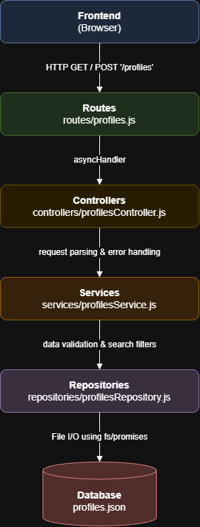

# CS326_GroupProject

| Name | GitHub Username |
| William Bae | willibae |
| Edelson Garcia | EmptyOffice |
| Alexandria Anderson | alexandriaan-hub |

Local Tennis Matchmaker in the Pioneer Valley area
- An application that connects tennis players in Amherst based on skill levels and schedule compatibility and also tracks court availability based on user input.
- This app addresses the frustrating process of finding well-matched hitting partners and the lack of visibility into public or campus court availability with the goals of fostering a more connected and active local community. 
- Recreational tennis players, junior athletes, and campus clubs in the area can benefit from this app.

Working agreement:
- We will communicate using Discord.
- "Done" for a PR means passing review from at least one teammate.
- We will resolve disagreements by discussing in person and voting at the end. 
- We will meet on Fridays at 1:20pm weekly. 

Instructions to run the server: 
- Clone the repository by entering the following into the terminal: 
    git clone https://github.com/EmptyOffice/CS326_GroupProject.git
- Change your directory in the terminal to the repository (...\CS326_GroupProject.git)
- Install the dependencies within the repository by entering the following into the terminal:
    npm install
- Start the server by entering the following into the terminal:
    npm start
- Visit the server at http://localhost:3000
- To close the server, enter CTRL+C into the terminal

## Feature: Player Profiles Page
The Player Profiles page lets you create a tennis player profile and search through all the players that have signed up.

1. **Go to the profiles page:** Start the server and open http://localhost:3000. Click the **Find a Partner** button on the home page, or go straight to http://localhost:3000/profiles. All saved players show up as cards under **Players** at the bottom of the page.
2. **Create a player profile:** Fill out the **Create a Profile** form. Name, age (14+), years played, and availability are required. USTA rating (1.0 - 7.0) and USTA ranking are optional, so players without a USTA rating can still sign up. Click **Create Profile** and the new player's card shows up in the list. The profile is saved to `profiles.json`, so it will still be there after the server restarts. If something is wrong (for example a missing field or an age under 14), an alert pops up with the error and nothing gets saved.
3. **Search the directory:** In the **Search Players** form, type part of a name, an exact USTA rating, and/or a max USTA ranking, then click **Search**. The list updates to only show matching players. Click **Clear** to empty the search boxes, then click **Search** again to see every player (searching with no filters will just show all players).

## System Architecture

### Feature: Player Profiles API
The backend currently exposes API for managing player profiles at the `/profiles` route. 

- **Fetching Profiles:** Sending a `GET` request to `/profiles` returns a JSON array of all registered players. You can also append query parameters to filter the results (e.g., `?name=william`, `?ustaRating=4.5`, or `?ustaRanking=10`).
- **Creating a Profile:** Sending a `POST` request to `/profiles` creates a new player. The request body must be a JSON object containing `name` (string), `age` (number, 14+), `yearsPlayed` (number, 0+), and `availability` (string). You may also optionally include `ustaRating` (1.0 - 7.0) and `ustaRanking` (positive number). 
- **What Happens After:** The server's service layer intercepts the request to validate all fields. If the data is malformed or missing required fields, it returns a `400 Bad Request` with a descriptive error message. If the data is valid, the repository assigns the player a unique ID, saves the new profile to the `profiles.json` database, and returns a `201 Created` status containing the newly saved profile object.

### API Request Flow
Here is the path of how client requests like fetching or creating a profile flow through our application backend:



```text
Frontend (Browser) 
  ↓ (HTTP GET / POST '/profiles')
Routes (routes/profiles.js)
  ↓ (asyncHandler)
Controllers (controllers/profilesController.js)
  ↓ (request parsing & error handling)
Services (services/profilesService.js)
  ↓ (data validation & search filters)
Repositories (repositories/profilesRepository.js)
  ↓ (File I/O using fs/promises)
Database (profiles.json)
```

### Design Decisions

William Bae: For handling errors in our backend, I decided to return custom success and error objects (like `{ ok: true }` or `{ ok: false, error }`) from our service file rather than throwing standard JavaScript errors and using try/catch in the controller. While using try/catch is the standard way to handle errors in Node.js, returning an object is better for our specific code because it forces us to explicitly check if a function worked (`if (!result.ok)`) before sending a response to the user. Also, a normal catch block can sometimes accidentally hide system crashes like spelling mistakes by treating them as user errors. By returning an error object on purpose, we get information as to why a validation failed without hiding bigger bugs.

Edelson Garcia: For the profiles page, I decided to have `profiles.ejs` render an empty `#profiles-list` and let `app.js` fill it in by fetching the JSON from `/api/profiles`. The alternative I'd say was to have the server pass the profiles into the EJS template and loop over them with `<% profiles.forEach(...) %>` kinda like some of the earlier exercises we did in the class, which is typically seen as a normal way to do it in Express. I think that our version is a bit better because the same JSON endpoint handles both the first load and every search, so searching or creating a profile updates the list without needing to reload the whole page, and the search boxes keep what you typed making it less frustrating for the user when searching/filtering. If we rendered the list on the server, every search would need a full page refresh, and the controller would need a second path that sends back HTML on top of the JSON one that `app.js` already uses right now. The cost of this design choice is that the list depends on JavaScript, so if `app.js` fails to load the page shows the forms but no players. This in my opninion is a fair sacraftice because every modern browser typically runs JavaScript and the forms already need it to submit.

Alexandria Anderson: For the client-side logic, I opted to ensure that USTA ratings and rankings are optional attributes by providing a default value for them when left unprovided. I chose to have these attributes contain a default "Unrated/Unranked" value in the case they were left unfilled. Alternatively, I could have filled these defaults with blank space, or made them undefined and passed them over to an if-else case that builds the player profile without these attributes entirely. However, the latter leads to a lack of consistency within the code and a need for further individual testing (in addition to the default profile with all fields present, 3 extra variations: missing unrated, unranked, or both). While this may keep the profiles as specific as possible, it might also hinder the simplicity of the code in the long run when these profiles may need to be passed to different functions and used elsewhere, as they'll also need to accommodate for multiple variations. Making the default value blank would remove the issue of needing further variations, but may confuse the user with its lack of clarity on why there is no value present. On the other hand, the option I chose avoids both of these potential issues while keeping both the code itself and what the user sees on the page clear and explicit about what information is and isn't present for each player.
