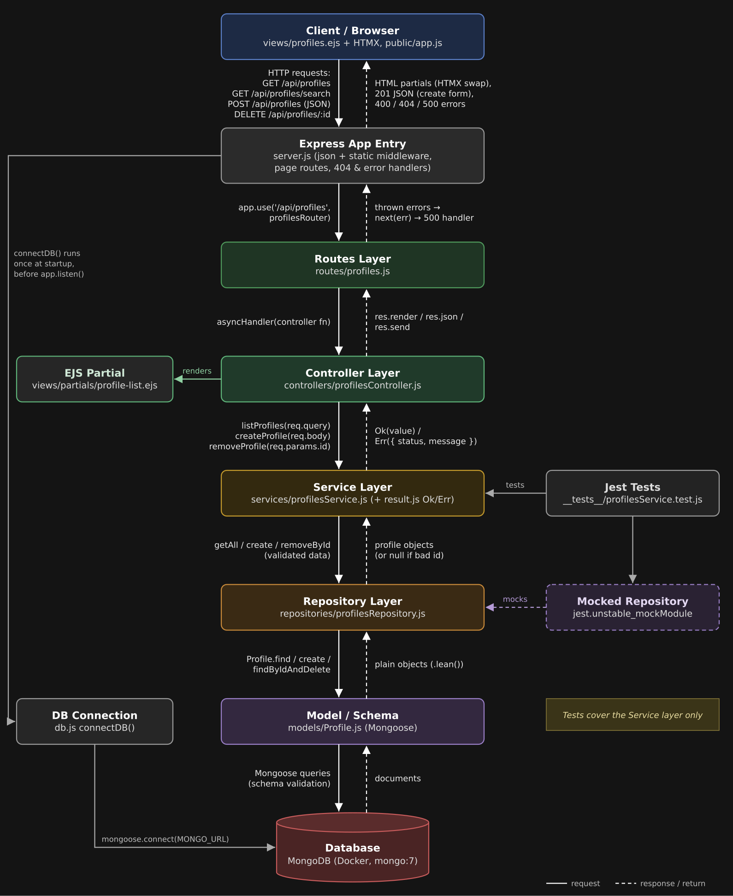

# CS326_GroupProject

| Name | GitHub Username |
| William Bae | willibae |
| Edelson Garcia | EmptyOffice |
| Alexandria Anderson | alexandriaan-hub |

Local Tennis Matchmaker in the Pioneer Valley area
- An application that connects tennis players in Amherst based on skill levels and schedule compatibility and also tracks court availability based on user input.
- This app addresses the frustrating process of finding well-matched hitting partners and the lack of visibility into public or campus court availability with the goals of fostering a more connected and active local community.
- Recreational tennis players, junior athletes, and campus clubs in the area can benefit from this app.

Working agreement:
- We will communicate using Discord.
- "Done" for a PR means passing review from at least one teammate.
- We will resolve disagreements by discussing in person and voting at the end.
- We will meet on Fridays at 1:20pm weekly.

Instructions to run the server:
- Clone the repository: `git clone https://github.com/EmptyOffice/CS326_GroupProject.git`
- Navigate into the directory: `cd CS326_GroupProject`
- Install dependencies: `npm install`
- Start your MongoDB database (e.g., via Docker Desktop using the provided docker-compose.yml)
- Build the Tailwind CSS: `npm run build:css`
- Start the server: `npm start`
- Visit the server at http://localhost:3000

## Feature: Player Profiles Page
The Player Profiles page lets you create a tennis player profile and search through all the players that have signed up.

1. **Go to the profiles page:** Start the server and open http://localhost:3000. Click the **Find a Partner** button on the home page, or go straight to http://localhost:3000/profiles. All saved players show up as cards under **Players** at the bottom of the page.
2. **Create a player profile:** Fill out the **Create a Profile** form. Name, age (14+), years played, and availability are required. USTA rating (1.0 - 7.0) and USTA ranking are optional, so players without a USTA rating can still sign up. Click **Create Profile** and the new player's card shows up in the list. The profile is saved to our MongoDB database, so it will still be there after the server restarts.
3. **Search the directory:** In the **Search Players** form, type part of a name, an exact USTA rating, and/or a max USTA ranking, then click **Search**. The list updates to only show matching players. Click **Clear** to empty the search boxes, then click **Search** again to see every player (searching with no filters will just show all players).

## Sprint 3 Updates
* **Database Migration:** Replaced `profiles.json` with a MongoDB database using Mongoose (isolating database operations within the Repository layer.)
* **HTMX Integration:** Replaced client-side JSON fetching with HTMX (`hx-get`, `hx-delete`) (allowing the server to dynamically swap EJS partials into the UI without page reloads.)
* **Tailwind CSS:** Transitioned the frontend styling to Tailwind CSS (utilizing utility classes and breakpoints for a responsive, mobile-first design.)
* **Jest Test Suite:** Implemented automated testing using Jest and `jest.unstable_mockModule` to mock the repository layer and independently verify service rules and controller logic.

## System Architecture

### Feature: Player Profiles API
The backend currently exposes API for managing player profiles at the `/api/profiles` route. 

- **Fetching Profiles:** Sending a `GET` request to `/api/profiles` returns an HTML partial (via EJS) of all registered players, designed to be swapped directly into the DOM using HTMX. You can also append query parameters to filter the results (e.g., `?name=william`, `?ustaRating=4.5`, or `?ustaRanking=10`).
- **Creating a Profile:** Sending a `POST` request to `/api/profiles` creates a new player. The request body must be a JSON object containing `name` (string), `age` (number, 14+), `yearsPlayed` (number, 0+), and `availability` (string). You may also optionally include `ustaRating` (1.0 - 7.0) and `ustaRanking` (positive number).
- **What Happens After:** The server's service layer intercepts the request to validate all fields. If the data is malformed or missing required fields, it returns a `400 Bad Request` with a descriptive error message. If the data is valid, the repository assigns the player a unique ID, saves the new profile to MongoDB, and returns a `201 Created` status containing the newly saved profile object.

### API Request Flow
Here is the path of how client requests like fetching or creating a profile flow through our application backend:

### Design Decisions

William Bae: For handling errors in our backend, I decided to return custom success and error objects (like `{ ok: true }` or `{ ok: false, error }`) from our service file rather than throwing standard JavaScript errors and using try/catch in the controller. While using try/catch is the standard way to handle errors in Node.js, returning an object is better for our specific code because it forces us to explicitly check if a function worked (`if (!result.ok)`) before sending a response to the user. Also, a normal catch block can sometimes accidentally hide system crashes like spelling mistakes by treating them as user errors. By returning an error object on purpose, we get information as to why a validation failed without hiding bigger bugs.

William Bae (Sprint 3): When implementing HTMX for our search filter, I chose to construct the server's HTML response using EJS partial files rather than returning raw HTML template strings directly from the controller. While returning raw HTML strings (e.g., `res.send('
' + profile.name + '
')`) would have technically worked, we decided to use EJS partials because it enforces separation of concerns and provides built-in security for our matchmaker app. Specifically for our app, if someone registered a player name containing HTML tags, building an HTML string directly in the controller would allow that HTML to run in the page when the HTMX search results render, and it will break the layout or run unwanted code. EJS prevents this by automatically escaping a player's name, so it is the safer choice.

Edelson Garcia (Sprint 2): For the profiles page, I decided to have `profiles.ejs` render an empty `#profiles-list` and let `app.js` fill it in by fetching the JSON from `/api/profiles`. The alternative I'd say was to have the server pass the profiles into the EJS template and loop over them with `<% profiles.forEach(...) %>` kinda like some of the earlier exercises we did in the class, which is typically seen as a normal way to do it in Express. I think that our version is a bit better because the same JSON endpoint handles both the first load and every search, so searching or creating a profile updates the list without needing to reload the whole page, and the search boxes keep what you typed making it less frustrating for the user when searching/filtering. If we rendered the list on the server, every search would need a full page refresh, and the controller would need a second path that sends back HTML on top of the JSON one that `app.js` already uses right now. The cost of this design choice is that the list depends on JavaScript, so if `app.js` fails to load the page shows the forms but no players. This in my opninion is a fair sacraftice because every modern browser typically runs JavaScript and the forms already need it to submit.

Edelson Garcia (Sprint 3): For the MongoDB swap, I decided to rewrite `profilesRepository.js` so it has per-record functions (`getAll`, `findById`, `create`, `updateById`, `removeById`) that each just call one Mongoose method, instead of keeping how we had it in Sprint 2 where `getAll` loaded every profile and `save` wrote the whole array back. The alternative I'd say was to keep `getAll` and `save` and just point them at a Mongo collection, which would've been the quicker way to do it since the service was already using those two. I think per-record is a bit better for our app because creating a profile now only adds that one player with `Profile.create()`, and deleting only touches the one profile with that `_id`, instead of reading and rewriting every single player each time. It also gives every player a real `_id` from Mongo, which is what the delete button on the profiles page uses now. If we kept the whole array version, two people making profiles at the same time could kinda overwrite each other, since the second save would write back a list that's missing the first person, and saving would get slower and slower as more players sign up. The cost of my choice was that I had to change `createProfile` in the service to call `create()` instead of `getAll()` and then `save()`, so the swap wasn't 100% only in the repository like the assignment wanted, but in my opinion that's a pretty small change for what we get out of it.

Edelson Garcia (Sprint 4): for login, i decided to use server side sessions with express session stored in mongodb with connect mongo, instead of jwts that the client holds onto and sends with every request. the alternative i'd say was jwts, which i've used before in a personal mobile app project, since a mobile app doesn't deal with browser cookies so the app just saves the token and sends it each time. i think sessions are a bit better for this app though because our pages are server rendered with ejs and htmx, so the browser already sends the session cookie on every request, and we didn't need extra client code to attach a token to each fetch or htmx call. logging out actually works with sessions since the logout route deletes the session on the server, while a jwt would kinda keep working until it expires unless we built a blocklist. the cost of my choice is that every request has to look up the session in mongo, and someone who just got made an admin has to log out and back in before it shows up. in my opinion that's a pretty small tradeoff for how simple it keeps everything.

Alexandria Anderson (Sprint 2): For the client-side logic, I opted to ensure that USTA ratings and rankings are optional attributes by providing a default value for them when left unprovided. I chose to have these attributes contain a default "Unrated/Unranked" value in the case they were left unfilled. Alternatively, I could have filled these defaults with blank space, or made them undefined and passed them over to an if-else case that builds the player profile without these attributes entirely. However, the latter leads to a lack of consistency within the code and a need for further individual testing (in addition to the default profile with all fields present, 3 extra variations: missing unrated, unranked, or both). While this may keep the profiles as specific as possible, it might also hinder the simplicity of the code in the long run when these profiles may need to be passed to different functions and used elsewhere, as they'll also need to accommodate for multiple variations. Making the default value blank would remove the issue of needing further variations, but may confuse the user with its lack of clarity on why there is no value present. On the other hand, the option I chose avoids both of these potential issues while keeping both the code itself and what the user sees on the page clear and explicit about what information is and isn't present for each player.

Alexandria Anderson (Sprint 3): I decided to use Jest's unstable_mockModule to implement unit tests that mock the repository layer rather than implement integration tests that interact with MongoDB and the repository directly. Although integration testing could guarantee the most accuracy by testing the code directly without emulating anything, and may be able to catch errors and interact with behavior specifically related to the database itself, since we are only using a specific part of MongoDB, I found it more practical to implement unit tests that simply mock the environment. Additionally, since we're only checking the business logic from profilesService with these tests, I would even say it's more effective to isolate these functions from how they interact with the database, in order to be able to test the logic itself. Also, mocking the repository means nothing within the repository layer will actually be affected, meaning there will be no changes made to any of the actual information stored in the database, and no data left behind to clean up after testing.

## Accessibility Audit (Sprint 4)

We audited the Home page (`/`) and the Player Profiles page (`/profiles`) using only the keyboard, and measured color contrast on the rendered pages (normal and hover states) with a WCAG contrast checker. The target is WCAG AA (at least 4.5:1 for text).

### Fixes

| # | Area | What we found | What we fixed | How to check |
|---|---|---|---|---|
| 1 | Keyboard | Every link, button and input could be reached with Tab, but the focus indicator was only the browser's thin default outline, which is hard to see on the blue and green buttons. | Added one consistent 3px blue focus ring for all links, buttons, inputs and focusable headings (`:focus-visible` rule in `src/input.css`). It only shows for keyboard users, not mouse clicks. | Press Tab through each page. Every control gets a thick blue outline, in top-to-bottom order: search fields, Search, Clear, the six create fields, Create Profile, then each card's Delete button. |
| 2 | Focus after delete | Deleting a card removed the Delete button that had focus, so focus fell back to the top of the page (`<body>`). | `public/app.js` remembers the card's neighbor before HTMX removes it, then moves focus to the next card's Delete button (or the previous one if it was the last card, or the "Players" heading if the list is now empty). | Tab to a Delete button in the middle of the list and press Enter. Focus lands on the next card's Delete button. Delete every card and focus lands on the "Players" heading. |
| 3 | Focus after create | Disabling the Create Profile button while saving dropped focus to `<body>`. Errors appeared in an `alert()` pop-up. | Focus returns to the Create Profile button after saving. Errors now appear inline under the form in a `role="alert"` box that screen readers read out. | Fill the form with the keyboard and press Enter on Create Profile. Focus stays on the button. Submit with a required field empty to see the inline error. |
| 4 | Screen reader updates | Search results, new profiles and deletions changed the page silently, so screen reader users got no feedback. | Added a hidden live region (`#status`, `aria-live="polite"`) that announces "3 players found.", "No players found.", "Profile created for ...", "... deleted." and "Could not delete ..." | With a screen reader on (VoiceOver: Cmd+F5, NVDA on Windows), run a search or delete a card and listen for the announcement. Or watch the `#status` element in DevTools. |
| 5 | Labels | The three search inputs (name, rating, ranking) had only placeholder text and no `<label>`. | Added a `<label for>` for each search input (visually hidden with `sr-only`, so the layout is unchanged). The six create-form inputs already had visible labels. Delete buttons now say which player they delete (`aria-label="Delete <name>"`). | In DevTools, inspect a search input: the Accessibility pane shows its name ("Search by name", etc.). With a screen reader, Tab to a Delete button and it reads "Delete Alice Kim". |
| 6 | Contrast | Measured on the rendered page: Create Profile button 3.22:1, Delete button 3.81:1, Clear button on hover 3.96:1, "No profiles found" text 3.81:1. All below 4.5:1. | Create Profile: `green-700` (hover `green-800`). Delete: `red-700` (hover `red-800`). Clear: hover lightens to `gray-200` with `gray-800` text. "No profiles found" and form errors: `red-700`. Footer text darkened to `gray-600`. Input borders darkened to `gray-500` so the fields are visible. | Use a contrast checker (e.g. the WebAIM Contrast Checker, or the contrast ratio in Chrome DevTools' color picker) on each item, including while hovering. |

### Contrast after the fixes (measured on the rendered page)

| Element | Normal | Hover |
|---|---|---|
| Search button (white on blue-600 / blue-700) | 5.25:1 | 6.83:1 |
| Clear button (gray-800 on gray-300 / gray-200) | 9.96:1 | 11.85:1 |
| Create Profile button (white on green-700 / green-800) | 4.95:1 | 7.13:1 |
| Delete button (white on red-700 / red-800) | 6.42:1 | 8.36:1 |
| "Find a Partner" link (white on blue-600 / blue-700) | 5.25:1 | 6.83:1 |
| Card body text (gray-600 on white) | 7.56:1 | n/a |
| Availability text (gray-500 on white) | 4.84:1 | n/a |
| "No profiles found" / error text (red-700) | 6.42:1 | n/a |
| Footer text (gray-600 on gray-50) | 7.23:1 | n/a |

## Testing
To run the automated tests for this application, run the following command in your terminal:
`npm test`

The test files are located in `__tests__/profilesService.test.js`.